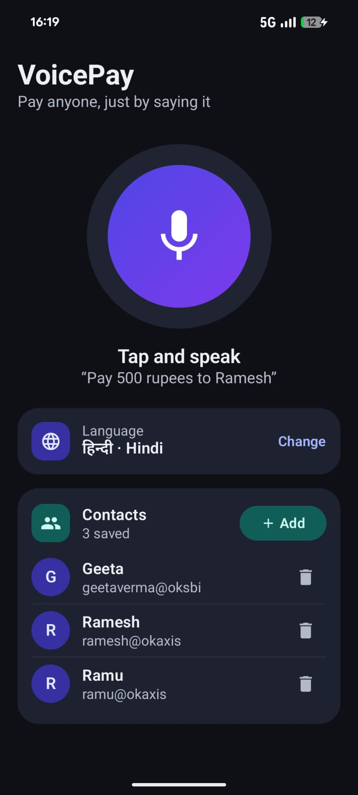
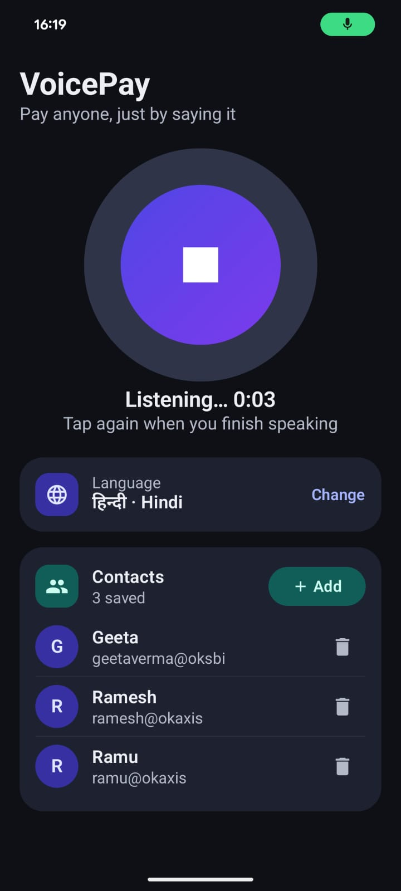
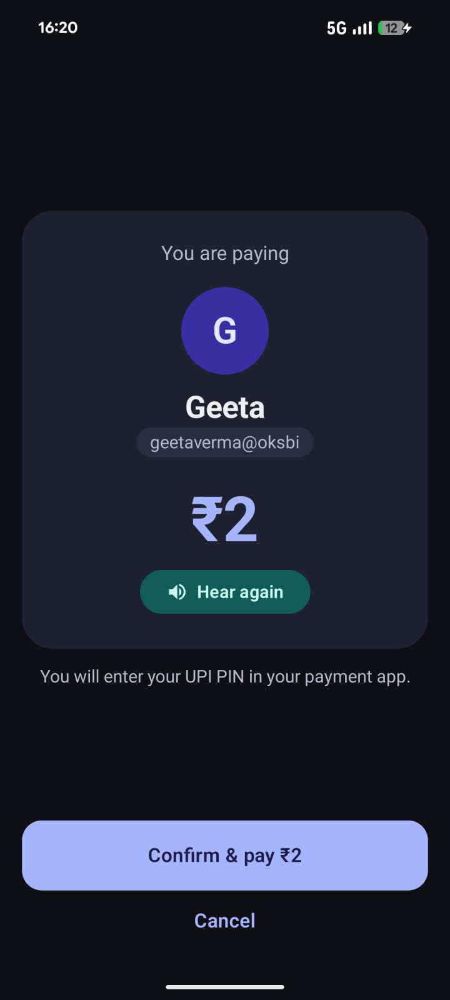
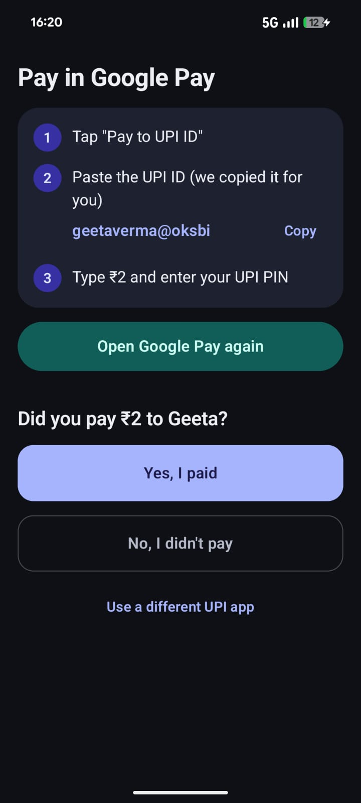
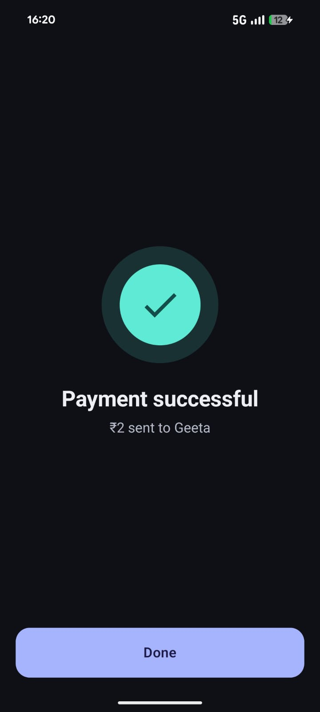

# VoicePay: Voice-Assisted UPI Payments

VoicePay is a prototype Android app that lets people start a UPI payment by speaking, in their own language. It is designed for **elderly users** who find it hard to open a payment app, find the right contact and type an amount.

The user says something like *"Ramu ko 500 bhej do"* ("send 500 to Ramu"). The app works out who to pay and how much, reads the payment back for confirmation, and then guides the user to pay in their own UPI app (Google Pay, PhonePe, Paytm and others), where they enter their PIN as usual.

> **One-page solution pitch:** [PITCH.md](PITCH.md)

> **Prototype scope.** This is a demo build, not a production payment app. VoicePay never moves money itself: the payment always happens inside the user's own UPI app. Security hardening, certification and robustness work are listed under [Known limitations](#known-limitations) and [Roadmap](#roadmap).

---

## Contents

- [Why VoicePay](#why-voicepay)
- [Features](#features)
- [Screenshots](#screenshots)
- [How it works](#how-it-works)
- [Safety by design](#safety-by-design)
- [Tech stack](#tech-stack)
- [Architecture](#architecture)
- [Contact matching](#contact-matching)
- [Languages](#languages)
- [The `/pay` API contract](#the-pay-api-contract)
- [Getting started](#getting-started)
- [Testing](#testing)
- [Deployment](#deployment)
- [Privacy and data handling](#privacy-and-data-handling)
- [Known limitations](#known-limitations)
- [Roadmap](#roadmap)

---

## Why VoicePay

UPI is everywhere in India, but payment apps are designed for people who are comfortable with smartphones. For many older users, the hard part isn't the payment itself. It's everything around it:

- **Navigation:** home screens full of offers, banners and menus make it easy to get lost.
- **Typing:** small keyboards and weaker eyesight make it easy to type 5000 instead of 500, or tap the wrong contact.
- **Language:** many users are far more comfortable speaking Hindi, Tamil or Bengali than reading English menus.
- **Fear of mistakes:** worry about sending money to the wrong person makes many people depend on family members.

VoicePay turns a multi-screen, typing-heavy task into one spoken sentence, and keeps an explicit confirmation step so the user stays in control.

---

## Features

- **Speak to pay:** one large mic button. Say who to pay and how much, in a natural sentence.
- **10 Indian languages:** Bengali, English, Gujarati, Hindi, Kannada, Malayalam, Marathi, Punjabi, Tamil and Telugu (see [Languages](#languages) for testing status).
- **Natural phrasing:** handles honorifics ("Ramesh uncle", "Sunil ji"), case endings ("रामू को", "ராமுக்கு"), number words ("paanch hazaar", "5k", "2 lakh") and mixed Hindi and English.
- **Spoken replies:** every reply is read aloud in the user's language, at a slightly slower speed (0.9×) for elderly listeners, and is also shown on screen.
- **Asks when unsure:** if the amount or name is missing, it asks for it. If two contacts match, it asks "Which one?".
- **Mandatory confirmation:** a Confirm screen shows the saved name, UPI ID and amount, and needs an explicit tap.
- **Guided hand-off to the UPI app:** copies the UPI ID, opens the user's chosen UPI app, and explains each step by voice. It then asks "Did you pay?" to record the result.
- **Contacts stay on the phone:** names and UPI IDs are stored only on the device.
- **Fallback voice:** if the server's text-to-speech fails, the phone's built-in voice reads the reply instead.

---

## Screenshots

A full payment, from speaking to the result (Hindi selected).

### 1. Home
One mic button, the chosen language and saved contacts.



### 2. Listening
The timer runs while the user speaks. Tap again to finish.



### 3. Confirm
The saved name, UPI ID and amount, read aloud. Nothing happens until the user taps Confirm.



### 4. Pay in the UPI app
The UPI ID is copied, the steps are spoken, and the app asks "Did you pay?" when the user returns.



### 5. Result
Shown after the user answers "Yes, I paid".



---


## How it works

```
 ANDROID APP                     BACKEND (Node.js)                   PROVIDERS
  │                                │                                   │
  │  record WAV (16 kHz, mono)     │                                   │
  │── POST /pay {audio, lang} ────►│  validate (schema, WAV, ≤ 30 s)   │
  │                                │── audio ─────────► Speech-to-text ─┤  Gnani (Vachana)
  │                                │◄──────────────── transcript ───────┤
  │                                │── transcript ────► LLM ────────────┤  Gemini
  │                                │◄──────────── {payee, amount} ──────┤
  │                                │  validate amount (₹1 – ₹5,00,000)  │
  │                                │── reply text ────► Text-to-speech ─┤  Gnani Timbre
  │                                │◄──────────────── MP3 ──────────────┤
  │◄── {status, speech, tts_audio, payment} ───│                        │
  │                                                                     │
  │  match payee against contacts saved on the phone                    │
  │  → Confirm screen → tap Confirm                                     │
  │  → copy UPI ID, open UPI app, voice guide → user pays + enters PIN  │
  │  → "Did you pay?" → result                                          │
```

**One request, end to end:**

1. The user taps the mic. The app checks for internet **before** recording, then records 16 kHz mono WAV, up to 30 seconds.
2. The app sends the recording (base64) and the chosen language code to `POST /pay`.
3. The backend validates the request cheaply first, so bad input never costs a paid API call.
4. **Speech-to-text** turns the audio into a transcript, for example "रामू को 500 भेज दो".
5. The **LLM** extracts `{"payee": "Ramu", "amount": 500}`. The backend checks the JSON and the amount limits.
6. The backend picks a reply from fixed templates ("रामू को 500 रुपये भेजें?"), and **text-to-speech** turns it into audio.
7. The app matches "Ramu" against the contacts saved on the phone and shows the **Confirm** screen.
8. On Confirm, the app copies the UPI ID, opens the user's UPI app and talks them through paying. When they come back, it asks "Did you pay?".

**Key principle:** the app only ever talks to the backend. Speech-to-text, the LLM and text-to-speech are all called from the backend, so **API keys never ship inside the app**.

---

## Safety by design

The core rule: **the AI only suggests a payment. The user and their own UPI app carry it out.**

| Risk | How VoicePay handles it |
|---|---|
| Speech is misheard | The payment is read back aloud and on screen, and needs an explicit Confirm tap. |
| The LLM makes up a name | Names are matched **only** against the user's saved contacts. The AI never sees or produces a UPI ID. |
| Similar names (Ramesh / Rakesh) | The matcher deliberately never matches names that are one letter apart. |
| Two contacts with the same name | The app shows a "Which one?" screen instead of guessing. |
| Invalid amount | The backend accepts only whole rupees from ₹1 to ₹5,00,000. Anything else is treated as missing, and the user is asked again. |
| "I received 500 from Ramu" | The LLM is instructed to recognise money coming *in*, which is not a payment. |
| Prompt injection in speech | The transcript is treated as data. The model can only return `{payee, amount}`, and code validates it. |
| Authorisation | Only the user's tap and their UPI PIN authorise a payment. The model never has an "approve" step. |

---

## Tech stack

| Layer | Technology |
|---|---|
| Android app | Kotlin 2.2, Jetpack Compose (Material 3), MVVM with `StateFlow`, coroutines |
| On-device storage | Room 2.8 (contacts), DataStore (settings) |
| Networking | Retrofit 3, OkHttp 4, kotlinx.serialization |
| Audio | `AudioRecord` (16 kHz mono PCM → WAV), `MediaPlayer` (MP3 replies), Android `TextToSpeech` (fallback) |
| Backend | Node.js 20+, TypeScript, Express 4, Zod |
| Speech-to-text | Gnani AI speech-to-text (Vachana endpoint `api.vachana.ai/stt/v3`) |
| Language model | Google Gemini (`gemini-3.5-flash-lite`) via its OpenAI-compatible API |
| Text-to-speech | Gnani AI Timbre (`timbre-v3.0`, voice "Shivani") |
| Hosting | Render (backend), signed release APK (app) |

---

## Architecture

### Android app (`android-app/`)

Min SDK 24 (Android 7.0), target SDK 37. Package `com.example.voicepay`.

| Component | Responsibility |
|---|---|
| `MainActivity` | Entry point. Chooses the screen for the current state, and handles the microphone permission. |
| `ui/VoicePayViewModel` | All app logic: recording, the backend call, contact matching and the payment hand-off. Owns one immutable `UiState`. |
| `ui/UiState` | Everything the UI shows. Screens are a sealed interface: Home, Confirm, ChooseContact, AddContact, FinishPayment, Result. |
| `ui/screens/` | Compose screens, plus the language and "Pay with" bottom sheets. |
| `voice/WavRecorder` | Records 16 kHz, 16-bit mono PCM on a background thread, adds a 44-byte WAV header, and stops at 30 s. |
| `voice/AudioPlayer` | Plays the backend's MP3 reply. |
| `voice/Speaker` | The phone's own text-to-speech: a fallback for replies, and the voice for the app's own prompts. |
| `voice/Prompts` | The app's own sentences ("not in your contacts", "Did you pay?") in all 10 languages. |
| `data/` | Room contacts database, DataStore settings, and `ContactMatcher`. |
| `network/PayApi` | Retrofit client for `POST /pay`, with generous timeouts for Render cold starts. |
| `payment/UpiApps` | Detects installed UPI apps and opens the chosen one. |

More detail, including release builds, is in [`android-app/README.md`](android-app/README.md).

### Backend (`backend/`)

A single stateless service: no database, no user accounts.

| File | Responsibility |
|---|---|
| `src/app.ts` | Express app: CORS, JSON body limit, `/health`, `/pay`, central JSON error handler (no stack traces sent to clients). |
| `src/routes/pay.ts` | Validates the request, runs speech-to-text → LLM → text-to-speech, and builds the response. |
| `src/services/stt.ts` | Speech-to-text client. |
| `src/services/llm.ts` | Extraction prompt and parsing. The model's JSON is validated with Zod and the amount is checked against limits. |
| `src/services/tts.ts` | Text-to-speech client. Returns base64 MP3. |
| `src/services/upstream.ts` | `UpstreamError` and `withRetry`: exponential backoff that retries only temporary failures (network errors, timeouts, 429, 5xx). |
| `src/replies.ts` | Fixed reply templates in all 10 languages. |
| `src/config.ts` | Environment variables, validated with Zod at startup. |
| `src/constants.ts` | Supported languages, timeouts, retry counts, amount and audio limits. |

**Timeouts and retries**

| Provider | Timeout per attempt | Attempts |
|---|---|---|
| Speech-to-text | 20 s | 3 |
| LLM | 30 s | 3 |
| Text-to-speech | 15 s | 2 |

If text-to-speech fails, the request still succeeds with `tts_audio: ""`, and the app uses the phone's voice instead.

### Design decisions

- **Native Android** (Kotlin and Jetpack Compose).
- **One backend**, not microservices. There is one action (pay) and one pipeline.
- **No MCP or tool calling.** Contact lookup and the UPI hand-off are plain functions in the app.
- **Adding a contact is a typed form,** not a voice action: dictating a UPI ID by voice is too error-prone.
- **Confirmation is a tap, not a spoken "yes",** which could be misheard or picked up from background speech.
- **Payment happens in the user's own UPI app.** UPI apps refuse `upi://pay` links from apps that aren't NPCI-approved (TPAPs), so VoicePay copies the UPI ID, opens the UPI app and talks the user through "Pay to UPI ID → paste → amount → PIN". Pre-filled payments would need TPAP approval through a bank partner.

---

## Contact matching

The LLM returns a **spoken** name (always in Latin script). `ContactMatcher` finds the saved contact it refers to. It tries four rules, **from strictest to loosest**, and stops at the first rule that matches anyone:

| Stage | Rule | Example |
|---|---|---|
| 1. Normalised | Lowercase, letters only, titles removed (ji, bhai, sir, uncle, didi…) | "Ramesh-ji!" → `ramesh` |
| 2. Phonetic | Smooths common spelling differences: ee→i, oo→u, sh→s, bh→b, repeated letters, a final "h" | "Preeti" = "Priti" |
| 3. First name | Compares only the first word | "Ramesh" = "Ramesh Kumar" |
| 4. Consonants | Keeps the first letter and drops later vowels | "Mohammad" = "Mohammed" |

- **One match** → Confirm screen. **Several matches** → "Which one?" screen. **No match** → offer to add the contact.
- A stricter stage always wins. "Ramesh Gupta" matches Ramesh Gupta exactly, even if "Ramesh Kumar" is also saved.
- **One-letter-off matches are deliberately not allowed.** Ramesh, Rakesh and Rajesh are different people, and this is money.

The matcher is covered by 10 unit tests in `ContactMatcherTest`.

---

## Languages

The user picks a language on first launch. It is sent with every request, because the speech-to-text service needs it and does not detect it automatically.

| Code | Language | Code | Language |
|---|---|---|---|
| `bn-IN` | Bengali | `ml-IN` | Malayalam |
| `en-IN` | English | `mr-IN` | Marathi |
| `gu-IN` | Gujarati | `pa-IN` | Punjabi |
| `hi-IN` | Hindi | `ta-IN` | Tamil |
| `kn-IN` | Kannada | `te-IN` | Telugu |

**Support status:**

| Component | Status |
|---|---|
| Speech-to-text and text-to-speech | All 10 languages, as supported by the provider |
| LLM extraction | Prompt examples in all 10 scripts |
| Spoken replies and app prompts | Written for all 10 languages, **not yet reviewed by native speakers** |
| On-screen text | English only |

---

## The `/pay` API contract

### Request: `POST /pay`

`Content-Type: application/json`

```jsonc
{
  "audio": "<base64 WAV>",
  "language_code": "hi-IN"
}
```

- **`audio`:** WAV, PCM 16-bit little-endian, 16 kHz, mono, base64-encoded, **at most 30 seconds** (960,044 bytes including the 44-byte header).
- **`language_code`:** one of the 10 codes above.

### Response: `200 OK`

Every successful response uses the same envelope:

```jsonc
{
  "status": "confirm | need_info | not_understood",
  "speech": "रामू को 500 रुपये भेजें?",   // reply text, in the request's language
  "tts_audio": "<base64 MP3, or \"\" if TTS failed>",
  "payment": {                          // only when status = confirm
    "payee_name": "Ramu",               // spoken name, romanised
    "amount": 500                       // whole rupees, 1 – 500000
  }
}
```

| `status` | Meaning | What the app does |
|---|---|---|
| `confirm` | Both name and amount understood | Matches the contact, then shows the Confirm screen |
| `need_info` | A payment was understood, but the name or amount is missing | Speaks the question and asks the user to say the whole sentence again |
| `not_understood` | Nothing usable was heard or understood | Speaks the message, user retries |
| `contact_not_found` | **Produced by the app only**, when the name matches no saved contact | Opens Add Contact with the name filled in |

- `tts_audio` is MP3 (mono, 24 kHz). If it's empty, the app reads `speech` with the phone's own voice.
- The backend never returns `contact_not_found`, because contacts live only on the device.

### Errors

| Status | When | Body |
|---|---|---|
| `400` | Invalid JSON, schema failure, not a WAV file, or audio longer than 30 s | `{ "error": "...", "issues": [...] }` |
| `413` | Request body larger than 10 MB | `{ "error": "Request body is too large" }` |
| `502` | Speech-to-text or the LLM failed after retries | `{ "error": "Could not process the request" }` |
| `500` | Unexpected server error | `{ "error": "Internal server error" }` |

### Health check

`GET /health` → `{ "ok": true }`

---

## Getting started

### Prerequisites

- **Backend:** Node.js 20 or later, and npm.
- **Android:** Android Studio (latest stable), and a physical Android phone (Android 7.0 or later) with USB debugging turned on. The microphone and UPI apps need a real device.
- **API keys:** Gnani AI (speech-to-text and text-to-speech) and Google AI Studio (Gemini).

### 1. Run the backend

```bash
cd backend
npm install
cp .env.example .env     # then fill in your API keys
npm run dev              # starts on http://localhost:3000 with auto-reload
```

Check that it's running:

```bash
curl http://localhost:3000/health
# {"ok":true}
```

### 2. Run the Android app

1. Open the `android-app/` folder (not the repository root) in Android Studio and let Gradle sync.
2. Set the backend URL in `android-app/app/build.gradle.kts` (`BACKEND_URL`). It currently points to the Render deployment.
3. Plug in your phone and press **Run**.

From the command line:

```bash
cd android-app
./gradlew :app:installDebug
```

> **Local development:** Android blocks plain `http://` traffic by default, so the easiest way to use a backend on your laptop is to expose it over HTTPS with a tunnel such as ngrok, and put that URL in `BACKEND_URL`.

### 3. First launch

1. Pick your language.
2. Add at least one contact (name and UPI ID). The mic button is enabled once both steps are done.
3. Tap the mic and say something like "Pay 500 rupees to Ramesh".

### Environment variables (`backend/.env`)

| Variable | Default | Purpose |
|---|---|---|
| `PORT` | `3000` | Port the server listens on |
| `STT_URL` | `https://api.vachana.ai/stt/v3` | Speech-to-text endpoint |
| `STT_API_KEY` | (required) | Speech-to-text API key |
| `LLM_URL` | Gemini OpenAI-compatible endpoint | LLM chat completions endpoint |
| `LLM_MODEL` | `gemini-3.5-flash-lite` | LLM model |
| `LLM_API_KEY` | (required) | Google AI Studio key |
| `TTS_URL` | `https://api.vachana.ai/api/v1/tts/inference` | Text-to-speech endpoint |
| `TTS_MODEL` | `timbre-v3.0` | Text-to-speech model |
| `TTS_VOICE` | `Shivani` | Text-to-speech voice |
| `TTS_API_KEY` | (required) | Text-to-speech API key |

**Never commit `.env`.** It is git-ignored.

---

## Testing

**Android unit tests** (run on your computer):

```bash
cd android-app
./gradlew :app:testDebugUnitTest
```

`ContactMatcherTest` has 10 tests covering case and titles, spelling variants, first-name matches, names that must **not** match (Rakesh, Sushil), unknown and empty names, ambiguous matches, and a stricter match beating a looser one.

**Backend checks:**

```bash
cd backend
npm run typecheck      # TypeScript, strict mode
npm run format:check   # Prettier
```

The backend does not have automated tests yet (see [Roadmap](#roadmap)).

---

## Deployment

- **Backend:** deployed on Render as a Node web service (`npm run build`, then `npm start`). API keys are set as Render environment variables. The free tier sleeps when idle, so the first request after a pause can take up to a minute. The app allows for this with a 90-second read timeout and a "waking up the server" message.
- **App:** a signed release APK, built with `./gradlew :app:assembleRelease` and installed directly on test phones. See [`android-app/README.md`](android-app/README.md) for signing details.

---

## Privacy and data handling

| Data | Where it lives | Notes |
|---|---|---|
| Contacts (name, UPI ID) | On the phone only (Room) | Never sent to the backend. The backend only ever sees a spoken name. |
| Voice recordings | In memory during a request | Not saved by the app or the backend. |
| Reply audio | One cache file on the phone | Overwritten on each reply. |
| Language and preferred UPI app | On the phone (DataStore) | |
| API keys | Backend environment variables only | Never in the app. |
| UPI PIN and money | The user's UPI app only | VoicePay never sees them. |

Audio and transcripts are processed by the speech-to-text, LLM and text-to-speech providers, under their own data policies.

---

## Known limitations

- **The final payment step is manual.** Without TPAP approval, the user has to paste the UPI ID and type the amount in their UPI app.
- **The payment result is self-reported.** The app can't see what happened in the UPI app, so it asks "Did you pay?".
- **No backend authentication or rate limiting yet.** Anyone with the URL could use up the API credits.
- **Follow-up answers are not merged.** If the app asks "How much?", the user has to say the whole sentence again.
- **Translations are unreviewed,** and the on-screen text is English only.
- **No automatic silence detection.** The user taps again to stop recording.
- **Cold starts** on the free hosting tier can make the first request slow.
- **Contacts saved in a native script** (for example "रामू") won't match, because the matcher compares Latin-script names.

---

## Roadmap

1. Per-device authentication, rate limiting and provider spending caps.
2. Backend tests with mocked providers, plus a labelled set of commands in every language to measure extraction accuracy.
3. A total time budget per request, so retries never outlast the app's timeout.
4. Remembering partial answers, so the user can just say "500" after "How much?".
5. Native-speaker review of all replies, and translated on-screen text.
6. Automatic stop when the user finishes speaking (voice activity detection).
7. Encrypting the contacts database and excluding it from cloud backups.
8. Pre-filled payments and real transaction status through NPCI/TPAP approval or a PSP SDK.

